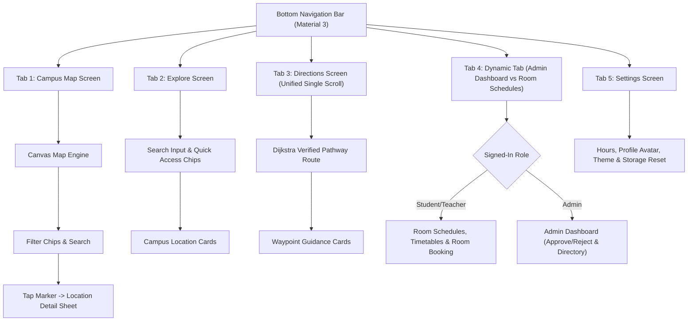
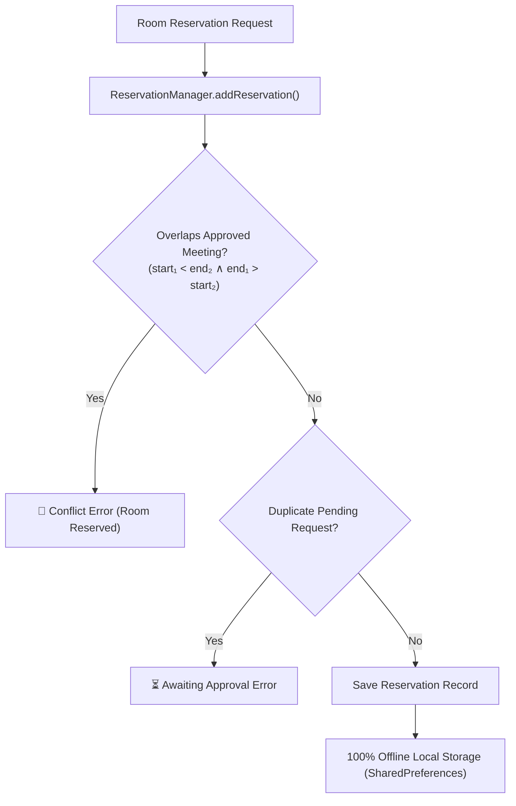
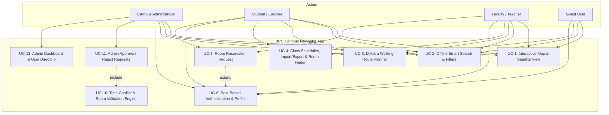
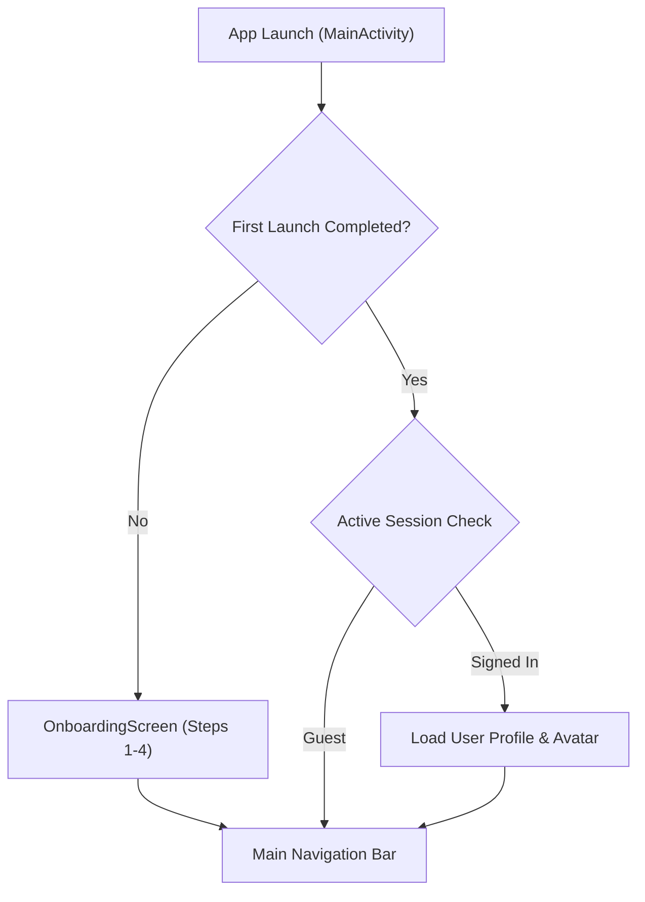

# 📍 BPC Campus Navigator

**An interactive campus map, walking route planner, class schedule manager, and room reservation system for Bulacan Polytechnic College, Main Campus (Malolos, Bulacan).**

[](https://bpcnav.vercel.app/)


> **CT-MAD-213: Mobile Application Development, Final Project**  
> Category 5: Maps and Geolocation Applications (Advanced complexity)  
> 🌐 **Download App via Website**: [https://bpcnav.vercel.app](https://bpcnav.vercel.app)

---

## 📖 Table of Contents

1. [Project Description](#-project-description)
2. [Features](#-features)
3. [Screenshots](#-screenshots)
4. [System Diagrams & Flowcharts](#-system-diagrams--flowcharts)
5. [Technologies Used](#-technologies-used)
6. [Installation and Setup Guide](#-installation-and-setup-guide)
7. [Demo Accounts](#-demo-accounts)
8. [Project Structure](#-project-structure)
9. [Testing](#-testing)
10. [Limitations](#-limitations)
11. [Developer](#-developer)
12. [Version Information](#-version-information)

---

## 📝 Project Description

**BPC Campus Navigator** is a native Android application built for Bulacan Polytechnic College (BPC) Main Campus in Malolos. It serves as an interactive campus directory, walking route planner, class timetable manager, room reservation system, and emergency alert hub. 

Students, faculty members, fresh enrollees, and guests can explore campus facilities, calculate walking routes, manage class schedules, find unoccupied rooms, request room reservations, and receive emergency broadcasts—all backed by robust on-device local storage, Supabase cloud synchronization capability, and OpenStreetMap tile rendering.

### Problem Statement

Finding your way around a campus is challenging for new enrollees, guest visitors, and students. Commercial map services (such as Google Maps or Mapbox) often lack detailed indoor and outdoor facility mapping for local academic institutions, requiring paid API keys and continuous internet connectivity. Additionally, students and teachers struggle with room schedule conflicts, missing class timetables, and double-bookings without a centralized approval, room finder, and alarm system.

### Proposed Solution

BPC Campus Navigator provides a complete, unified Android solution featuring:
1. **Interactive OpenStreetMap Map Engine (OSMDroid)**: Tile-based zoom/pan map, free ESRI satellite imagery toggle, and custom colored pin markers for 20 campus facilities with live busy meeting badges.
2. **Dijkstra Pedestrian Pathway Route Planner**: Verified walking routes along pedestrian pathways with step-by-step turn-by-turn waypoint guidance.
3. **Class Schedule Management & Import/Export**: Complete weekly timetable management with ICS/JSON file import/export and class reminder alarms.
4. **Free Room Finder Modal**: Instant querying of currently unoccupied rooms across campus for study groups or makeup classes.
5. **Role-Based Authentication & Admin Approval Dashboard**: Student, Teacher, and Admin accounts with a centralized queue for approving or rejecting room reservation requests.
6. **Real-Time Schedule Conflict Prevention Engine**: Automated time-overlap validation ($\text{start}_1 < \text{end}_2 \land \text{end}_1 > \text{start}_2$) that prevents double-booking.
7. **Emergency Broadcasts & Alarms**: Real-time emergency announcements, high-priority foreground notifications, full-screen emergency alarm activities, and audio sirens.
8. **On-Device Storage & Supabase Cloud Sync**: Account profiles, search history, saved favorites, class schedules, and room reservations stored locally with Supabase cloud backup options.

### Target Users

| User | What they do with the app |
|------|---------------------------|
| **Students and enrollees** | Find lecture rooms, ComLab 1, science labs, the NTT lab, printing services, and restrooms. Manage class timetables, search for free rooms, and submit room requests for study groups or events. |
| **Faculty and teachers** | Find academic offices and the medical clinic. Submit room booking requests for makeup classes or department meetings, manage teaching timetables, and broadcast academic notices. |
| **Campus administrators** | Review pending reservations (Approve ✓ / Reject ✗), view the system user directory, monitor room utilization stats, and trigger campus-wide emergency broadcasts. |
| **Visitors and guests** | Find the main arch gate, canteen, activity center, stage, food stalls, and receive emergency broadcast notices. |

---

## ✨ Features

### 🗺️ Interactive Campus Map Engine
- OpenStreetMap tiles via OSMDroid with pinch-to-zoom, pan, and double-tap controls, centered on BPC Main Campus (`14.8665° N, 120.8068° E`)
- One-tap satellite layer toggle using **ESRI World Imagery** aerial view
- 20 color-coded category pin markers for BPC facilities with live **🔴 BUSY** meeting status badges
- Location detail sheet to inspect floor information, coordinates, description, notes, user distance (`You: ~X.X km away`), copy coordinates, share location, and request room reservations
- Quick camera actions: **`[🏫 Center BPC Campus]`** button and **`[🎯 Pinpoint My Location]`** button with instant camera re-centering

### 🔍 Smart Search & Category Filtering
- Multi-attribute case-insensitive search matching facility names, categories, floor levels, descriptions, and keywords (*"CR"*, *"ComLab"*, *"canteen"*, *"printing"*)
- Google Maps-style floating search bar with an elevated dropdown list appearing while typing
- Category filter chips for instant pin filtering on the map: Academic Buildings, Offices, Laboratories, Restrooms, Food & Dining, Stores, Health, and Amenities

### 🧭 Campus Route Planner & Waypoints
- Dijkstra shortest-path algorithm calculating optimal walking routes along verified campus pedestrian pathways
- Flexible origin selection: start from current GPS position or any campus room
- Out-of-bounds GPS handling: automatically falls back to BPC Main Entrance Arch Gate when the user's GPS position is > 2 km outside campus
- Unified single-scroll guidance: step-by-step turn-by-turn waypoint cards rendered in a continuous scroll view

### 📅 Class Schedule Management, Import/Export & Free Room Finder
- Personalized weekly timetables: add, edit, and organize courses, room assignments, and time slots
- ICS / JSON schedule importer & exporter: import timetable files or export schedules to share with classmates
- **Free Room Finder Modal**: instantly search for currently available rooms across campus to hold study groups or makeup sessions
- Schedule alarms: automated class reminder notifications and alarm scheduling

### 🔑 Role-Based Sign-In & Admin Dashboard
- 3 user roles: Student / Enrollee, Faculty / Teacher, and Campus Administrator
- Demo quick sign-in buttons for testing and defense demonstration:
  - 👑 **Admin**: `admin@bpc.edu.ph` / `admin123`
  - 👨‍🏫 **Teacher**: `teacher@bpc.edu.ph` / `teacher123`
  - 🎓 **Student**: `student@bpc.edu.ph` / `student123`
- Centralized admin dashboard overview stat cards (Pending Requests Queue Count, Active Meetings Count, Registered Users Count)
- Pending approval queue with controls (**[Approve ✓]** / **[Reject ✗]**) directly on pending request cards
- System user directory listing registered Students, Teachers, and Admins with Student/Employee ID numbers

### 🛡️ Schedule Conflict Prevention Engine
- Time overlap detection validating new bookings against approved schedules ($\text{start}_1 < \text{end}_2 \land \text{end}_1 > \text{start}_2$)
- Conflict blocking: displays red conflict error banner in the reservation modal if the room is already booked
- Spam and duplicate protection: prevents duplicate pending requests for the same room and time slot, disabling the submit button on click
- Ownership authorization: students and teachers can ONLY cancel their own submitted pending requests

### 🚨 Emergency Broadcasts & Alarms
- Emergency alert banner prominently displaying active campus emergency warnings
- Emergency contacts card with quick-dial links for campus security, medical clinic, and local emergency services
- Full-screen emergency alarm activity with flashing warning visuals and audio sirens for campus-wide emergencies

### 🎨 Material 3 Styling, Themes & Profile Management
- **BPC Green Brand Theme**: Material 3 theme palette matching BPC's official forest green school logo (`#15803D`) with Light and Dark mode support
- Circular profile avatar badge displaying user initials (*e.g., "CA"*, *"MS"*, *"JD"*) with role color indicators
- Edit profile modal to modify Full Name, Student/Employee ID Number, Email, and Password

---

## 📸 Screenshots

| Map | Search and Filters | Location Details |
|:---:|:---:|:---:|
|  |  |  |

| Route Planner | Reserve a Room | Admin Dashboard |
|:---:|:---:|:---:|
|  |  |  |

| Profile | Dark Mode |
|:---:|:---:|
|  |  |

---

## 📊 System Diagrams & Flowcharts

Below are the architectural flowcharts, navigation layout, reservation logic, and use case diagrams for BPC Campus Navigator. You can also view the detailed markdown documentation in the [`diagrams/`](diagrams/) directory:

### 1. Navigation & Feature Flowchart (Tabs 1–5)


### 2. Room Reservation & Conflict Prevention Flowchart


### 3. Use Case Diagram (UC-1 to UC-16)


### 4. App Launch & Onboarding Flowchart


---

## 🛠️ Technologies Used

| Layer | Technology | Purpose |
|-------|-----------|---------|
| Language | **Kotlin 2.0.21** | Type-safe native Android development |
| UI toolkit | **Jetpack Compose (Material 3)** | Declarative UI following Material Design 3 guidelines |
| Architecture | **Single Activity + Navigation Compose 2.8.8** | Navigation with a bottom navigation bar; StateFlow for reactive state |
| Map SDK | **OSMDroid 6.1.18** (`org.osmdroid:osmdroid-android`) | Free, open-source OpenStreetMap tile rendering SDK |
| Satellite imagery | **ESRI World Imagery** | Free high-resolution aerial satellite tiles |
| Location API | **Android Location API (`LocationManager`)** | Hardware GPS and Network provider location listener |
| Persistence | **Android `SharedPreferences`** | Local JSON storage for accounts, reservations, schedules, favorites, and history |
| Cloud Sync | **Supabase SDK** (`io.github.jan-tennert.supabase`) | Optional cloud database synchronization |
| Algorithms | **Dijkstra's Shortest Path** | Graph route calculation over campus pedestrian pathway nodes |
| Distance | **Haversine formula** | Distances between coordinates in meters |
| Build Tool | **Gradle 8.13 / Android Gradle Plugin 9.4.1** | Build automation, dependency management, and resource merging |
| IDE | **Android Studio Ladybug (2024.2.1)** | Development environment |
| Version control | **Git and GitHub** | Source management |

---

## ⚡ Installation and Setup Guide

### Option A: Install the APK (quickest)

1. Download `BPCCampusNav.apk` from the official website **[https://bpcnav.vercel.app](https://bpcnav.vercel.app)** or the repository's **Releases** page.
2. On your Android phone, open the downloaded file.
3. If Android blocks the install, allow installs from your browser or file manager when prompted, then tap **Install**.
4. Open the app and allow **location access** so the map can center on you and plan routes from your position.

> Requires Android 7.0 (API 24) or higher. Only install APKs from sources you trust.

### Option B: Build from source

**Requirements**

| Tool | Version |
|------|---------|
| Android Studio | Ladybug (2024.2.1) or newer |
| JDK | 17 |
| Gradle | 8.13+ (the included wrapper handles this) |
| Device / emulator | Android 7.0 (API 24) or higher |

**Steps**

1. **Clone the repository**
   ```bash
   git clone https://github.com/KirGetVal/BPCCampusNav2.git
   cd BPCCampusNav2
   ```

2. **Open in Android Studio**
   - Choose **File > Open** and select the `BPCCampusNav2` root folder.
   - Let Gradle sync dependencies.

3. **Verify the build**
   ```bash
   # Run unit tests
   ./gradlew app:testDebugUnitTest

   # Build a debug APK
   ./gradlew app:assembleDebug
   ```
   On Windows, use `gradlew.bat` instead of `./gradlew`. The debug APK is created at `app/build/outputs/apk/debug/`.

4. **Run on a device or emulator**
   - **Physical device:** enable USB debugging, connect it, and select it in Android Studio.
   - **Emulator:** create an Android Virtual Device (API 24 or higher) in Device Manager.
   - Click **Run 'app'** (`Shift + F10`).

---

## 🔐 Demo Accounts

The sign-in screen has quick-login buttons. You can also type these credentials manually:

| Role | Email | Password |
|------|-------|----------|
| 👑 Admin | `admin@bpc.edu.ph` | `admin123` |
| 👨‍🏫 Teacher | `teacher@bpc.edu.ph` | `teacher123` |
| 🎓 Student | `student@bpc.edu.ph` | `student123` |

> These accounts are for testing and demonstration only.

---

## 📂 Project Structure

```
BPCCampusNav2/
├── app/
│   ├── build.gradle.kts
│   └── src/
│       ├── main/
│       │   ├── AndroidManifest.xml
│       │   ├── java/com/kgvtech/bpccampusnav2/
│       │   │   ├── MainActivity.kt        # Single activity entry point
│       │   │   ├── alarm/                 # Emergency & Schedule Alarm Broadcast Receivers
│       │   │   ├── data/                  # Models & Managers: Reservation, Schedule, Supabase, Auth
│       │   │   ├── location/              # GPS LocationManager wrapper
│       │   │   ├── map/                   # OsmMapView tile engine & Canvas
│       │   │   ├── navigation/            # AppNavigation & Screen routes
│       │   │   ├── routing/               # RouteGraph & DistanceCalculator
│       │   │   ├── search/                # CampusSearch engine
│       │   │   ├── ui/
│       │   │   │   ├── activities/        # Emergency & Schedule Alarm Activities
│       │   │   │   ├── components/        # DetailSheet, BookRoomDialog, ProfileHeader, FreeRoomFinder
│       │   │   │   ├── screens/           # Map, Explore, Directions, Schedules, Admin, Settings
│       │   │   │   └── theme/             # BPC Green Theme Palette, Color, Type
│       │   │   └── utils/                 # Share, Clipboard, Sound & Schedule Exporter/Importer
│       │   └── res/                       # Drawables, launcher icons, strings, colors, themes
│       └── test/                          # CampusDataAndRoutingTest.kt
├── diagrams/                              # Dedicated Use Case & System Flowchart Markdown files
├── gradle/                                # Wrapper and libs.versions.toml
├── build.gradle.kts
├── documentation/                         # Project documentation report
├── screenshots/                           # README screenshots
└── README.md
```

### Architecture

```
Presentation   CampusMapScreen · ExploreScreen · DirectionsScreen · Schedules · ClassSchedulesScreen · OsmMapView · DetailSheet
     │  StateFlow and callbacks
Business logic AuthManager · ReservationManager · ClassScheduleManager · EmergencyAlertManager · RouteGraph (Dijkstra) · Search
     │  JSON serialization
Data           SharedPreferences (users, reservations, schedules, favorites, history) · Supabase (optional sync) · OSMDroid cache
```

---

## 🧪 Testing

Run the suite with `./gradlew app:testDebugUnitTest`. All 8 tests pass.

| ID | Category | Target | Expected result | Status |
|----|----------|--------|-----------------|:------:|
| TC-01 | Dataset integrity | `CampusLocations.allLocations` | Exactly 20 locations (A–T) with unique IDs and valid GPS | ✅ |
| TC-02 | Restroom records | `LocationCategory.RESTROOM` | Exactly 4 restrooms (2 Boys CR, 2 Girls CR) | ✅ |
| TC-03 | Footprint geometry | `GeometryType.APPROXIMATE_FOOTPRINT` | Activity Center and Building B use opposite corner coordinates | ✅ |
| TC-04 | Search engine | `CampusSearch.search()` | Case-insensitive matches for "science", "comlab", "CR", "2nd floor" | ✅ |
| TC-05 | Distance | `DistanceCalculator` | Accurate Haversine distance between entrance and main building | ✅ |
| TC-06 | Dijkstra routing | `RouteGraph.findRoute()` | Walking path with step waypoints | ✅ |
| TC-07 | Ongoing meetings | `RoomReservation.isOngoing()` | True for active approved reservations | ✅ |
| TC-08 | Schedule conflict | `ReservationManager.hasTimeConflict` | Rejects overlapping bookings for the same room and time | ✅ |

---

## ⚠️ Limitations

- Map tiles (OpenStreetMap and ESRI satellite) need an internet connection the first time an area is displayed.
- GPS centering and routing from your position need location permission.
- The operating hours banner follows the general Asia/Manila campus schedule (7:00 AM to 9:00 PM).
- Data is stored locally, so accounts and reservations are not shared between devices unless Supabase cloud sync is configured.

## 🚀 Future Enhancements

- **Push notifications:** local alerts 15 minutes before a reserved meeting.
- **Indoor floor plans:** multi-floor overlays for buildings such as Building B and ComLab 1.
- **QR check-in:** scan a code at the room entrance to check in for a reserved slot.

---

## 👤 Developer

| Name | Role | GitHub |
|------|------|--------|
| **Kirby Vallinas** (KGV Tech) | Developer | [@KirGetVal](https://github.com/KirGetVal) |

**Course:** CT-MAD-213, Mobile Application Development  
**Institution:** Bulacan Polytechnic College, Main Campus (Malolos, Bulacan)

## 🏷️ Version Information

| | |
|---|---|
| **Version** | 2.1.0 |
| **Branch** | `main` |
| **Min Android** | 7.0 (API 24) |
| **Package** | `com.kgvtech.bpccampusnav2` |

---

<p align="center">Made for the students of Bulacan Polytechnic College 💚</p>
